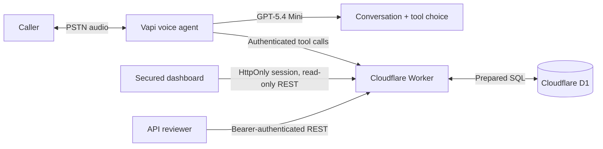

# CareCloud Voice Patient Registry

A voice-based patient registration demo built for the CareCloud AI Engineer assessment. Callers speak naturally with a Vapi agent, review and explicitly confirm their demographics, and the agent persists the record through a Cloudflare Worker REST API backed by D1. A secured dashboard exposes the resulting synthetic records and call outcomes.

> **Use synthetic data only.** This is an assessment implementation, not a HIPAA-compliant production healthcare system.

## Submission details

Live assessment endpoints:

- **Repository:** `https://github.com/NihalAli19/carecloud-voice-patient-registry`
- **Assessment overview:** `https://carecloud-voice-patient-registry.nihalaliytt.workers.dev/`
- **U.S. phone number:** `+1 864-625-5246`
- **API base URL:** `https://carecloud-voice-patient-registry.nihalaliytt.workers.dev`
- **Dashboard:** `https://carecloud-voice-patient-registry.nihalaliytt.workers.dev/dashboard`
- **Machine API credential:** provide `API_KEY` privately only when the reviewer needs direct REST write testing; dashboard reviewers can create an account

## Architecture



One Worker owns routing, validation, persistence, Vapi webhooks, OpenAPI output, and the dashboard. This deliberately avoids microservices: they would add deployment and failure points without improving a three-hour assessment.

Operational references:

- [Test plan](docs/TESTING.md)
- [Security policy](SECURITY.md)

## Why this stack

| Layer | Choice | Honest rationale |
| --- | --- | --- |
| Telephony/orchestration | Vapi | Fastest credible path to a natural phone agent. Vapi currently offers one free inbound U.S. number without a saved payment method. The number is free; calls and AI usage are not. |
| LLM | OpenAI GPT-5.4 Mini through Vapi | Better latency/cost fit than a flagship reasoning model for structured intake and tool calling. Override with `VAPI_MODEL`. |
| Speech | Deepgram Nova-3 + Vapi Voice Clara v2 | Low-latency transcription, multilingual detection, and a professional voice without managing two more service integrations. |
| API/runtime | Cloudflare Workers | No sleeping instance, global edge runtime, free request allowance, and a small operational surface. |
| Database | Cloudflare D1 | Persistent relational storage, SQL constraints, indexes, backups/time travel, and direct Worker binding. |
| Dashboard | Server-rendered HTML/CSS/JS from the Worker | No separate frontend deployment or build pipeline; same-origin API calls and a polished reviewer surface. |

Current official limits and vendor behavior should be rechecked before submission: [Vapi free number](https://docs.vapi.ai/free-telephony), [Cloudflare Workers pricing](https://developers.cloudflare.com/workers/platform/pricing/), and [D1 limits](https://developers.cloudflare.com/d1/platform/limits/).

## Implemented requirements

- Natural LLM-led intake prompt with interruptions, out-of-order answers, spelling corrections, and restart handling.
- All required demographics and caller-selected optional fields.
- Specific validation for names, date of birth, U.S. phone numbers, state, ZIP, email, and member ID.
- Full readback and explicit confirmation enforced both in the prompt and at the write tool boundary.
- Duplicate lookup by phone, race-safe active-phone uniqueness, and a DOB-verified update offer.
- Persistent SQL schema with constraints, indexed filters, UTC timestamps, and UUID identifiers.
- Complete REST CRUD with partial `PUT`, soft delete, pagination, filters, correct status codes, and a consistent envelope.
- Idempotent REST and Vapi registration with payload fingerprints to prevent retry-created duplicates and key reuse with changed data.
- Authenticated mutation/read API and separately authenticated Vapi webhook.
- End-of-call transcript/summary storage linked to the patient when registration succeeds.
- English/Spanish language switching.
- Public reviewer overview with a call-first test journey, synthetic test profile, and simple sign-in/account-creation entry points.
- Responsive account-protected dashboard with D1-backed users, PBKDF2 password hashes, HttpOnly sessions, lockout protection, and a clear return path.
- OpenAPI 3.1 document at `/openapi.json` and human summary at `/docs`.
- Structured stdout logs, health check, request IDs, nonce-based CSP/security headers, bounded request bodies, and no hardcoded secrets.
- Unit and security regression tests, tracked-file secret scanning, dependency auditing in CI, local migrations, and deployment dry-run validation.

## API

Machine clients use `Authorization: Bearer <API_KEY>`. Same-origin dashboard sessions may read patient and call routes, but create, update, and delete operations always require the machine API key.

| Method | Route | Behavior |
| --- | --- | --- |
| `GET` | `/health` | Worker and D1 health |
| `GET` | `/patients` | Active patients; supports `last_name`, `date_of_birth`, `phone_number`, `limit`, `offset` |
| `GET` | `/patients/:id` | One active patient by UUID |
| `POST` | `/patients` | Create; optional `Idempotency-Key` header |
| `PUT` | `/patients/:id` | Partial update |
| `DELETE` | `/patients/:id` | Soft delete by setting `deleted_at` |
| `GET` | `/calls` | Recent call outcomes |
| `POST` | `/webhooks/vapi` | Vapi tool calls and end-of-call reports |

Success envelope:

```json
{ "data": { "patient_id": "..." }, "error": null }
```

Error envelope:

```json
{
  "data": null,
  "error": {
    "code": "VALIDATION_FAILED",
    "message": "One or more patient fields are invalid.",
    "details": { "date_of_birth": "Must be a real, non-future date in MM/DD/YYYY format." }
  }
}
```

## Local setup

Prerequisites: Node.js 22+ and a free Cloudflare account for eventual deployment.

```bash
npm install
cp .env.example .dev.vars
npm run db:migrate:local
npm run dev
```

On PowerShell, replace the copy command with:

```powershell
Copy-Item .env.example .dev.vars
```

Generate strong, different `API_KEY` and `VAPI_WEBHOOK_SECRET` values in `.dev.vars`. The local app is then available at `http://localhost:8787`; start at `/` for the reviewer journey or open `/dashboard` directly for registry access.

Validation and build checks:

```bash
npm run check
npx wrangler deploy --dry-run
```

Release verification helpers read credentials only from environment variables:

- `npm run smoke:api` requires `PUBLIC_BASE_URL`, `API_KEY`, and `VAPI_WEBHOOK_SECRET`; it uses synthetic data and soft-deletes created patients.
- `npm run smoke:auth` requires `PUBLIC_BASE_URL` and verifies signup, duplicate prevention, session reads, write denial, signout, and signin. Run it against local D1 because it leaves a synthetic test account.
- `npm run verify:public` requires `PUBLIC_BASE_URL` and checks health, documentation, and browser security headers.
- `npm run verify:vapi` requires the Vapi IDs and private credentials and reads back the live assistant/phone configuration without printing secrets.

## Cloudflare deployment

1. Authenticate and create D1:

   ```bash
   npx wrangler login
   npx wrangler d1 create carecloud-patient-registry
   ```

2. Confirm the D1 binding in `wrangler.toml` uses your returned database ID and set `ENVIRONMENT = "production"`. Keep `ALLOWED_ORIGIN` empty for this same-origin dashboard; set it only when a separate, trusted frontend origin needs browser CORS access.

3. Store secrets; do not put them in `wrangler.toml`:

   ```bash
   npx wrangler secret put API_KEY
   npx wrangler secret put VAPI_WEBHOOK_SECRET
   ```

4. Apply the schema and deploy:

   ```bash
   npm run db:migrate:remote
   npm run deploy
   ```

5. Verify `/health`, then create and retrieve one synthetic patient before connecting Vapi.

## Vapi setup

The complete system prompt is versioned at [`config/assistant-prompt.md`](config/assistant-prompt.md). The configuration script creates or updates an assistant without writing secrets to the repository. The live assessment currently uses the assistant and U.S. number listed above.

PowerShell example:

```powershell
$env:VAPI_API_KEY = "your-private-vapi-key"
$env:PUBLIC_BASE_URL = "https://carecloud-voice-patient-registry.nihalaliytt.workers.dev"
$env:VAPI_WEBHOOK_SECRET = "the-same-secret-stored-in-cloudflare"
node scripts/configure-vapi.mjs
```

To update an existing assistant, also set `VAPI_ASSISTANT_ID`. To attach a number already created in Vapi, set `VAPI_PHONE_NUMBER_ID`.

For the free assessment number:

1. In the Vapi dashboard, open **Phone Numbers → Create Phone Number → Free Vapi Number**.
2. Choose an available U.S. area code. Activation can take a few minutes.
3. Assign **CareCloud Patient Intake** as the inbound assistant.
4. Add Vapi or OpenAI credits before the reviewer calls. A free number does **not** make calls free.
5. Call twice: register on call one, then use the same phone number on call two and verify the duplicate/update flow.

The script defaults to Vapi-managed model/speech access. Add your OpenAI provider key in Vapi Integrations if you want billing and request logs directly in your OpenAI account.

## Security and resilience

- Patient endpoints are not anonymous. Dashboard reads require a valid D1-backed account session; machine reads and every mutation require the bearer API key.
- Passwords use salted PBKDF2-SHA-256 hashes, never plaintext. Session tokens are stored only as SHA-256 hashes and delivered in HttpOnly, SameSite=Strict cookies with Secure enabled over HTTPS.
- Five failed password attempts lock the account for 15 minutes. Browser authentication POSTs reject cross-site origins.
- Vapi uses a different bearer secret, so reviewer API access cannot forge voice webhooks.
- Every caller-influenced field is validated again at the server boundary; unknown fields, control characters, invalid NANP numbers, and oversized bodies are rejected.
- SQL values use prepared statements; dynamic column names come only from a fixed allowlist.
- Writes require explicit confirmation; updates to an existing record also require a caller-stated matching date of birth. Prompt instructions alone are not trusted.
- Vapi call IDs are idempotency keys, preventing common retry duplication; reusing a key with different data is rejected.
- A database-level partial unique index prevents concurrent active records with the same phone number. Deletes remain reversible soft deletes.
- Recording is disabled. Transcripts are stored because the assessment explicitly rewards them.
- Database failures produce a spoken failure instruction; the agent must not claim registration succeeded.
- If a call drops before confirmation, no patient is written. The end-of-call report can still preserve the transcript for debugging.

## Known limitations and trade-offs

Brutally honest version:

- **This does not provide 99.9999999999% uptime.** No free stack does. Workers Free and D1 have enforced quotas and no enterprise SLA; Vapi, the carrier, speech services, and the model are additional dependencies.
- **This is not HIPAA compliant.** It lacks a BAA configuration, formal access control, audit governance, retention policy, key rotation process, consent workflow, and compliance validation. Never enter real PHI.
- Dashboard accounts are named, but sign-up is intentionally open and there is no email verification, password reset, invitation approval, MFA, RBAC, or tenant isolation. Any registered account can read all synthetic records. That is acceptable only for this public assessment—not a clinic.
- D1 is single-writer SQLite infrastructure. It is more than enough for this assessment, but a high-volume production intake platform should load-test and may need Postgres.
- Vapi’s free number is inbound-only, cannot be ported out, and still consumes paid call/AI credits.
- Transcript logs and the assessment-required final-payload stdout log contain synthetic demographics. Production logging would require redaction and a defined retention policy.
- The LLM can still mishear speech. Server validation catches malformed values, but only realistic call simulations and human review establish conversational quality.

## Production upgrade path

For a real healthcare deployment: establish BAAs with every data processor, use an identity provider with RBAC, segregate tenants, encrypt selected fields at the application layer, redact logs, define retention/deletion workflows, add audit events, synthetic monitoring, alerting, load tests, rate limiting, a queue for durable webhook processing, cross-region recovery, and an explicit SLO/error budget. Those are material projects—not checkboxes that should be faked in a take-home README.
