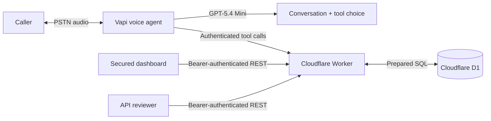

# CareCloud Voice Patient Registry

A voice-based patient registration demo built for the CareCloud AI Engineer assessment. Callers speak naturally with a Vapi agent, review and explicitly confirm their demographics, and the agent persists the record through a Cloudflare Worker REST API backed by D1. A secured dashboard exposes the resulting synthetic records and call outcomes.

> **Use synthetic data only.** This is an assessment implementation, not a HIPAA-compliant production healthcare system.

## Submission details

Fill these in after deployment:

- **Repository:** `https://github.com/NihalAli19/carecloud-voice-patient-registry`
- **U.S. phone number:** `+1 (...) ...-....`
- **API base URL:** `https://carecloud-voice-patient-registry.<account>.workers.dev`
- **Dashboard:** `https://carecloud-voice-patient-registry.<account>.workers.dev/dashboard`
- **API credential:** provide the reviewer with the production `API_KEY` through a private channel

## Architecture



One Worker owns routing, validation, persistence, Vapi webhooks, OpenAPI output, and the dashboard. This deliberately avoids microservices: they would add deployment and failure points without improving a three-hour assessment.

## Why this stack

| Layer | Choice | Honest rationale |
| --- | --- | --- |
| Telephony/orchestration | Vapi | Fastest credible path to a natural phone agent. Vapi currently offers one free inbound U.S. number without a saved payment method. The number is free; calls and AI usage are not. |
| LLM | OpenAI GPT-5.4 Mini through Vapi | Better latency/cost fit than a flagship reasoning model for structured intake and tool calling. Override with `VAPI_MODEL`. |
| Speech | Deepgram Nova-3 + Vapi Voice Clara v2 | Low-latency transcription, multilingual detection, and a professional voice without managing two more service integrations. |
| API/runtime | Cloudflare Workers | No sleeping instance, global edge runtime, free request allowance, and a small operational surface. |
| Database | Cloudflare D1 | Persistent relational storage, SQL constraints, indexes, backups/time travel, and direct Worker binding. |
| Dashboard | Server-rendered HTML/CSS/JS from the Worker | No separate frontend deployment or build pipeline; same-origin API calls and a polished reviewer surface. |

Current official limits and vendor behavior should be rechecked before submission: [Vapi free number](https://docs.vapi.ai/free-telephony), [Cloudflare Workers pricing](https://developers.cloudflare.com/workers/platform/pricing/), and [D1 limits](https://developers.cloudflare.com/d1/platform/limits/).

## Implemented requirements

- Natural LLM-led intake prompt with interruptions, out-of-order answers, spelling corrections, and restart handling.
- All required demographics and caller-selected optional fields.
- Specific validation for names, date of birth, U.S. phone numbers, state, ZIP, email, and member ID.
- Full readback and explicit confirmation enforced both in the prompt and at the write tool boundary.
- Duplicate lookup by phone and update offer.
- Persistent SQL schema with constraints, indexed filters, UTC timestamps, and UUID identifiers.
- Complete REST CRUD with partial `PUT`, soft delete, pagination, filters, correct status codes, and a consistent envelope.
- Idempotent REST and Vapi registration to protect against retry-created duplicates.
- Authenticated mutation/read API and separately authenticated Vapi webhook.
- End-of-call transcript/summary storage linked to the patient when registration succeeds.
- English/Spanish language switching.
- Responsive API-key-protected dashboard.
- OpenAPI 3.1 document at `/openapi.json` and human summary at `/docs`.
- Structured stdout logs, health check, request IDs, security headers, and no hardcoded secrets.
- Unit tests plus local migration and deployment dry-run validation.

## API

All patient and call routes require `Authorization: Bearer <API_KEY>`.

| Method | Route | Behavior |
| --- | --- | --- |
| `GET` | `/health` | Worker and D1 health |
| `GET` | `/patients` | Active patients; supports `last_name`, `date_of_birth`, `phone_number`, `limit`, `offset` |
| `GET` | `/patients/:id` | One active patient by UUID |
| `POST` | `/patients` | Create; optional `Idempotency-Key` header |
| `PUT` | `/patients/:id` | Partial update |
| `DELETE` | `/patients/:id` | Soft delete by setting `deleted_at` |
| `GET` | `/calls` | Recent call outcomes |
| `POST` | `/webhooks/vapi` | Vapi tool calls and end-of-call reports |

Success envelope:

```json
{ "data": { "patient_id": "..." }, "error": null }
```

Error envelope:

```json
{
  "data": null,
  "error": {
    "code": "VALIDATION_FAILED",
    "message": "One or more patient fields are invalid.",
    "details": { "date_of_birth": "Must be a real, non-future date in MM/DD/YYYY format." }
  }
}
```

## Local setup

Prerequisites: Node.js 22+ and a free Cloudflare account for eventual deployment.

```bash
npm install
cp .env.example .dev.vars
npm run db:migrate:local
npm run dev
```

On PowerShell, replace the copy command with:

```powershell
Copy-Item .env.example .dev.vars
```

Generate strong, different `API_KEY` and `VAPI_WEBHOOK_SECRET` values in `.dev.vars`. The local app is then available at `http://localhost:8787`; the dashboard is `/dashboard`.

Validation and build checks:

```bash
npm run check
npx wrangler deploy --dry-run
```

## Cloudflare deployment

1. Authenticate and create D1:

   ```bash
   npx wrangler login
   npx wrangler d1 create carecloud-patient-registry
   ```

2. Replace `REPLACE_AFTER_RUNNING_WRANGLER_D1_CREATE` in `wrangler.toml` with the returned database ID. Set `ENVIRONMENT = "production"`. Set `ALLOWED_ORIGIN` to the final Worker origin after the first deploy.

3. Store secrets; do not put them in `wrangler.toml`:

   ```bash
   npx wrangler secret put API_KEY
   npx wrangler secret put VAPI_WEBHOOK_SECRET
   ```

4. Apply the schema and deploy:

   ```bash
   npm run db:migrate:remote
   npm run deploy
   ```

5. Verify `/health`, then create and retrieve one synthetic patient before connecting Vapi.

## Vapi setup

The complete system prompt is versioned at [`config/assistant-prompt.md`](config/assistant-prompt.md). The configuration script creates or updates an assistant without writing secrets to disk.

PowerShell example:

```powershell
$env:VAPI_API_KEY = "your-private-vapi-key"
$env:PUBLIC_BASE_URL = "https://carecloud-voice-patient-registry.<account>.workers.dev"
$env:VAPI_WEBHOOK_SECRET = "the-same-secret-stored-in-cloudflare"
node scripts/configure-vapi.mjs
```

To update an existing assistant, also set `VAPI_ASSISTANT_ID`. To attach a number already created in Vapi, set `VAPI_PHONE_NUMBER_ID`.

For the free assessment number:

1. In the Vapi dashboard, open **Phone Numbers → Create Phone Number → Free Vapi Number**.
2. Choose an available U.S. area code. Activation can take a few minutes.
3. Assign **CareCloud Patient Intake** as the inbound assistant.
4. Add Vapi or OpenAI credits before the reviewer calls. A free number does **not** make calls free.
5. Call twice: register on call one, then use the same phone number on call two and verify the duplicate/update flow.

The script defaults to Vapi-managed model/speech access. Add your OpenAI provider key in Vapi Integrations if you want billing and request logs directly in your OpenAI account.

## Security and resilience

- Patient endpoints are not anonymous. A bearer key is required even for reads.
- Vapi uses a different bearer secret, so reviewer API access cannot forge voice webhooks.
- Every caller-influenced field is validated again at the server boundary.
- SQL values use prepared statements; dynamic column names come only from a fixed allowlist.
- Writes require explicit confirmation; a prompt instruction alone is not trusted.
- Vapi tool-call IDs are idempotency keys, preventing common retry duplication.
- Deletes are reversible soft deletes.
- Recording is disabled. Transcripts are stored because the assessment explicitly rewards them.
- Database failures produce a spoken failure instruction; the agent must not claim registration succeeded.
- If a call drops before confirmation, no patient is written. The end-of-call report can still preserve the transcript for debugging.

## Known limitations and trade-offs

Brutally honest version:

- **This does not provide 99.9999999999% uptime.** No free stack does. Workers Free and D1 have enforced quotas and no enterprise SLA; Vapi, the carrier, speech services, and the model are additional dependencies.
- **This is not HIPAA compliant.** It lacks a BAA configuration, formal access control, audit governance, retention policy, key rotation process, consent workflow, and compliance validation. Never enter real PHI.
- The dashboard uses a shared API key rather than named users and roles. That is acceptable for a reviewer demo, not a clinic.
- D1 is single-writer SQLite infrastructure. It is more than enough for this assessment, but a high-volume production intake platform should load-test and may need Postgres.
- Vapi’s free number is inbound-only, cannot be ported out, and still consumes paid call/AI credits.
- Transcript logs and the assessment-required final-payload stdout log contain synthetic demographics. Production logging would require redaction and a defined retention policy.
- The LLM can still mishear speech. Server validation catches malformed values, but only realistic call simulations and human review establish conversational quality.

## Production upgrade path

For a real healthcare deployment: establish BAAs with every data processor, use an identity provider with RBAC, segregate tenants, encrypt selected fields at the application layer, redact logs, define retention/deletion workflows, add audit events, synthetic monitoring, alerting, load tests, rate limiting, a queue for durable webhook processing, cross-region recovery, and an explicit SLO/error budget. Those are material projects—not checkboxes that should be faked in a take-home README.
